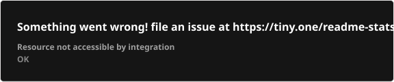

Me chamo Eufy Ribeiro, tenho 19 anos e sou natural de Teresina, Piauí. Atualmente curso Engenharia da Computação com ênfase em Inteligência Artificial na Uni-CET e Tecnologia em Banco de Dados com ênfase em Ciência de Dados no Piauí Instituto de Tecnologia. Tenho grande interesse por tecnologia, com foco nas áreas de Ciência de Dados e Machine Learning.

###

  
  
  

###

###

  
  
  
  
  
  
  
  
  
  
  

###

 

  
  

###

 

###

  

###

 

<h2 data-importer="text" align="left">Connect with me!</h2>

###
